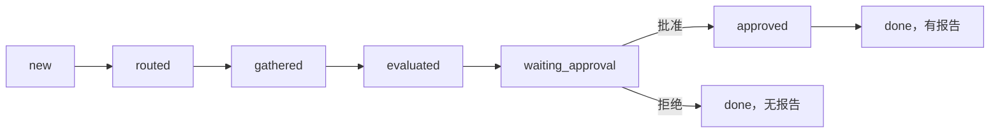

# 06.1｜工作流、状态机与选择边界

**学习目标：** 把任务写成可验证的状态转移，而不是含糊的提示词。

Workflow（工作流）预先定义步骤、分支与退出条件。Agent（智能体）可在边界内动态选择下一步。若任务主要路径已知，先用工作流表达；只有路径需要根据新证据临时规划，且评测证明收益时，才增加动态决策。

本实验的状态是 `new → routed → gathered → evaluated → waiting_approval → approved → done`。拒绝审批则从 `waiting_approval` 直接进入 `done`，且没有报告。状态记录包含运行 ID、请求、当前阶段和可序列化数据。**状态是系统事实；模型输出只是待验证数据。**

每次转移检查预期旧状态。旧状态不匹配时返回 `stale_checkpoint`，防止过期调用覆盖新进度。运行 ID 与请求绑定，同一 ID 换请求必须拒绝。

**实践任务：** 在 [示例](../../examples/workflow_lab.py) 中增加一个只查风险的路由，画出新增状态转移，并说明数据应在哪里校验。

**验收标准：** 每条路径都有终态；重复恢复不会重新执行已提交阶段；非法状态转移被拒绝。

**失败案例：** 仅保存“第 4 步”而不保存证据，重启后无法复现报告，也无法核查来源。

[下一讲：路由、并行与评估修订](02-routing-parallel-evaluator.md)
