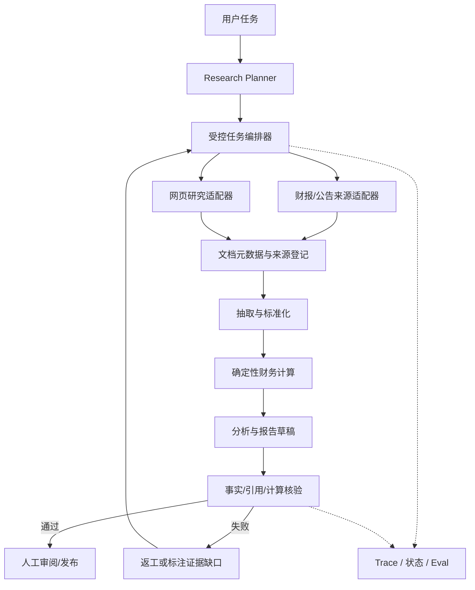

# 综合项目：架构设计

## 状态对象建议

- `task_id` / `run_id`：标识一次研究任务及运行。
- `issuer_id` / `exchange` / `as_of_date`：公司身份与截止日期。
- `sources[]`：URL、发布日期、检索时间、文档哈希、来源类型。
- `facts[]`：事实名称、数值、单位、期间、口径、来源位置。
- `assumptions[]`：假设、分析逻辑、反例条件。
- `tool_events[]`：工具、参数摘要、返回状态、耗时、错误类别。
- `review_status`：待核验、通过、退回、待人工审核。

## 关键架构取舍

- `fetch` 与 `write/report` 分离；前者默认只读，后者可能需要人审。
- 来源内容为不可信数据，不可覆盖系统规则或用户授权。
- 可重复的指标计算使用代码，不依赖 LLM 心算。
- 任何字段缺失应返回 `unknown` 与缺失原因，不能补写猜测数字。
- 先构建端到端评测，再决定是否采用多个 Agent 分工。
